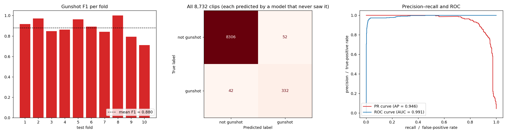
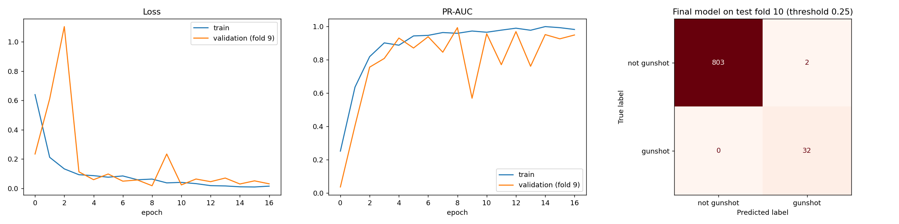

# ShotShield — Gunshot Detection in Urban Audio

ShotShield is a convolutional neural network that listens to audio and flags gunshots. It turns sound into
mel spectrograms, scans them in 4-second windows, and reports **where** in a recording a gunshot was likely
fired. It was trained and evaluated on the 8,732 labelled clips of
[UrbanSound8K](https://urbansounddataset.weebly.com/urbansound8k.html), where gunshots have to be told apart
from nine other city sounds: sirens, drilling, jackhammers, car horns, dogs, engines, air conditioners,
street music and children playing.

**[▶ Try the live demo](https://nishttw.github.io/ShotShield/)**: it listens to your microphone and runs the
model in your browser. Your audio is never uploaded.


## Results

| Evaluation | Precision | Recall | F1 | ROC-AUC | PR-AUC |
|---|---|---|---|---|---|
| **10-fold cross-validation** (mean ± std, threshold 0.5) | 0.892 ± 0.143 | 0.897 ± 0.128 | **0.880 ± 0.089** | 0.989 ± 0.033 | 0.966 ± 0.086 |
| Final model, held-out test fold 10 (threshold 0.25) | 0.941 | 1.000 | 0.970 | 1.000 | 0.996 |

All numbers are for the **gunshot** class, measured with UrbanSound8K's official folds. Slices of one
recording never appear in both the training and the test data. Accuracy is left out on purpose: gunshots are
only 4.3% of the clips, so a model that never predicts "gunshot" would already score 95.7%.

- **Across all 8,732 clips** (each predicted by a model that never saw it), ShotShield caught **332 of 374
  gunshots (89%)** and raised **52 false alarms among 8,358 other sounds (0.6%)**.
- **The final model** caught all 32 gunshots in test fold 10, with 2 false alarms in 805 other clips. Its
  threshold (0.25) was picked on fold 9 before fold 10 was touched.
- **Cross-validation is the honest headline.** Results vary a lot between folds: F1 ranges from 0.71 to
  1.00, and fold 9 is clearly the hardest (ROC-AUC 0.90). The same test fold 10 scored F1 0.71 in
  cross-validation but 0.97 with the final model, so results also vary between training runs. Per-fold
  numbers are in [`results/cv_results.csv`](results/cv_results.csv).





### What it gets wrong

**False alarms by class** (cross-validation, threshold 0.5): of the 52 false alarms, the largest groups are
air conditioners (19), drilling (8) and idling engines (8). Children playing and dog barks have 5 each, sirens 3,
street music and jackhammers 2 each, and car horns none. Steady machine noise with sharp clicks or onsets is the
main weakness. Adding more hard negatives of this kind is the clearest way to improve.

**Shortcut check:** most gunshot clips are short, so a model could learn "short clip ⇒ gunshot".

| Clip length | Non-gunshot clips | False-alarm rate | Gunshot recall |
|---|---|---|---|
| < 1 s | 364 | 1.6% | 0.88 |
| 1–2 s | 357 | 1.4% | 0.89 |
| 2–3 s | 203 | 1.0% | 0.89 |
| 3–4 s | 116 | 1.7% | 0.83 |
| 4 s (full) | 7,318 | 0.5% | **0.94** |

Gunshot recall doesn't drop for long clips; it's actually highest for full 4 s clips. So the model is
not detecting gunshots by clip length. Short *non*-gunshot clips do trigger false alarms about 3× more often
than full-length ones (1–1.7% vs 0.5%). This is a small but real side effect of loop padding: repeating a
short clip can create a train of sharp onsets that resembles gunfire.

## How it works

```
audio file ──► resample to 22,050 Hz mono
           ──► split into 4 s windows (1 s hop)
           ──► log-mel spectrogram, 128 bands × 173 frames, scaled 0–1
           ──► CNN ──► P(gunshot) per window
           ──► windows above the threshold merged into time ranges
```

**Model:** three convolution blocks (32 → 64 → 128 filters, BatchNorm, ReLU, max pooling, dropout), then global
average and global max pooling, a 64-unit dense layer and a sigmoid output: 304,289 parameters. Global
max pooling fits the task: one loud, short event anywhere in the window should be enough to fire.

**Training:** Adam, binary cross-entropy, balanced class weights for the rare gunshot class, early stopping on
validation PR-AUC. The decision threshold is tuned on the validation fold and then applied unchanged to the
test fold.

## From v1 to v2: what I fixed

The first version of ShotShield ([`notebooks/v1_original.ipynb`](notebooks/v1_original.ipynb)) reported high
accuracy. A closer look showed it wasn't measuring what I thought it was:

| Problem in v1 | Why it mattered | Fix in v2 |
|---|---|---|
| Trained on **gunshot vs dog bark** only | Any other sound (a siren, a drill) was forced into one of those two answers | Gunshot vs **all** nine other classes |
| Short clips padded with **0 dB**, the *loudest* value after `power_to_db(ref=max)` | Most gunshot clips are short, so the model could learn "padding ⇒ gunshot" | Short clips are **looped** to fill 4 s, and a shortcut check in the notebook confirms clip length isn't being used |
| Random `train_test_split` | Slices of the same recording ended up in both train and test, inflating the score | The official 10 folds and 10-fold cross-validation |
| Accuracy as the only metric | Meaningless with 4% positives | Precision, recall, F1, ROC-AUC, PR-AUC, confusion matrix |
| `Flatten → Dense(64)`: 5.2M parameters, 99% in one layer | Large, overfits, tied to one input size | Global pooling: about 17× fewer parameters |
| Label order and preprocessing not saved | Inference code had to guess | `model_info.json` stores labels, threshold and feature settings |

## Quick start

```bash
git clone https://github.com/nishttw/ShotShield.git
cd ShotShield
pip install -r requirements.txt
```

Download `shotshield_v2.keras` and `model_info.json` from the
[Releases page](https://github.com/nishttw/ShotShield/releases) into `models/`. Then:

```bash
python predict.py path/to/recording.wav
```

```bash
python app.py
```

`predict.py` prints whether a gunshot was found and when. `app.py` starts a web demo at
http://127.0.0.1:7860 where you can upload or record audio.

## Browser demo

The [live demo](https://nishttw.github.io/ShotShield/) (in [`docs/`](docs), served by GitHub Pages) runs the
same model without a server:

```
microphone (raw: no noise suppression, no auto gain)
  ──► AudioWorklet ──► windowed-sinc resampler (48 / 44.1 kHz → 22,050 Hz)
  ──► rolling 4 s buffer, every 1 s:
  ──► log-mel spectrogram in JavaScript (docs/js/features.js)
  ──► ONNX model in ONNX Runtime Web (WebAssembly) ──► P(gunshot), threshold 0.25
```

**It matches the Python pipeline numerically.** The JavaScript front-end is a port of
[`features.py`](src/shotshield/features.py): STFT with a periodic Hann window, `center=True` with zero padding,
librosa's own Slaney mel filterbank (exported as JSON), and `power_to_db(ref=max, top_db=80)`. Its output is
checked against librosa, and the full browser path is checked against the Keras model:

| Check | Script | Largest difference |
|---|---|---|
| JS log-mel vs librosa (noise, tones, clicks, loop padding, multi-window clips, silence) | `tools/verify_features.py` | ~1.2e-7 (float32 rounding, 0.00001 dB) |
| ONNX vs Keras on the same features (19 windows, on Kaggle) | `notebooks/shotshield_v2_export_web.ipynb` | 1.8e-7 |
| JS features → ONNX vs librosa → Keras, on synthetic signals and test-fold clips | `tools/verify_onnx.py` | 2.4e-7, same decision on every window |
| The same, inside the browser (page → "Check this browser against Python") | `docs/js/app.js` | 8.7e-6 in Chrome (WebAssembly) |

The model was converted to ONNX on Kaggle with
[`notebooks/shotshield_v2_export_web.ipynb`](notebooks/shotshield_v2_export_web.ipynb). It downloads the
v2.0 release, checks its SHA-256, tries several converters and keeps the first one that matches Keras on
every reference window. To update the demo with a new bundle:

```bash
python tools/install_web_bundle.py shotshield_v2_web.zip
```

```bash
python tools/verify_features.py --reference tools/reference/reference.npz
```

```bash
python tools/verify_onnx.py
```

The verification scripts need Node.js and `pip install onnxruntime`.

## Retraining

Open [`notebooks/shotshield_v2_training.ipynb`](notebooks/shotshield_v2_training.ipynb) on Kaggle, add the
UrbanSound8K dataset, enable a GPU and run all cells. It extracts the features, runs 10-fold cross-validation,
trains the final model and packages everything into `shotshield_v2_outputs.zip`.

## Repository layout

```
├── docs/                              browser demo (GitHub Pages): page, JS front-end, ONNX model, example clips
├── tools/                             export the mel filterbank, install the web bundle, verification scripts
├── notebooks/
│   ├── shotshield_v2_training.ipynb   training + evaluation (Kaggle)
│   ├── shotshield_v2_export_web.ipynb Keras → ONNX conversion + reference data (Kaggle)
│   └── v1_original.ipynb              first version, kept for comparison
├── src/shotshield/
│   ├── features.py                    audio → log-mel spectrogram (same settings as training)
│   └── detector.py                    sliding-window inference and event merging
├── predict.py                         command-line tool
├── app.py                             Gradio web demo
├── assets/                            figures used in this README
├── results/                           per-fold results and the model's settings (model_info.json)
└── models/                            put the downloaded model here (not stored in git)
```

## Limitations

- **Research project, not a safety system.** Don't rely on it to detect real gunfire.
- UrbanSound8K holds 374 gunshot clips from a limited set of recordings. Real-world gun types, distances,
  indoor echoes and microphones vary far more.
- Sharp impulsive sounds (slamming doors, fireworks, backfiring engines) aren't in the training data, so they
  are a likely source of false alarms.
- Clips are judged in 4-second windows; the model doesn't count individual shots.
- Results vary between folds and between training runs (see Results). Averaging several models trained
  with different seeds would make it more stable.

## Ideas for future work

- Add hard negatives (fireworks, door slams) from other datasets such as ESC-50 or FSD50K.
- SpecAugment and background-noise mixing to make it more robust.
- Convert to TensorFlow Lite and run on a Raspberry Pi with a microphone.

## Dataset and credits

UrbanSound8K by J. Salamon, C. Jacoby and J. P. Bello, released under CC BY-NC 3.0. The audio isn't
included in this repository; download it from the [official site](https://urbansounddataset.weebly.com/urbansound8k.html)
or Kaggle.

> J. Salamon, C. Jacoby and J. P. Bello, "A Dataset and Taxonomy for Urban Sound Research",
> 22nd ACM International Conference on Multimedia, Orlando, USA, Nov. 2014.

## License

Code: [MIT](LICENSE). The trained model was learned from UrbanSound8K, so use it for non-commercial purposes only.
