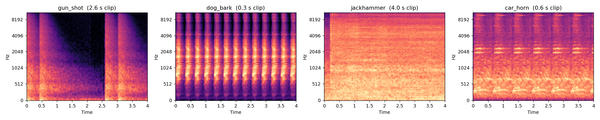
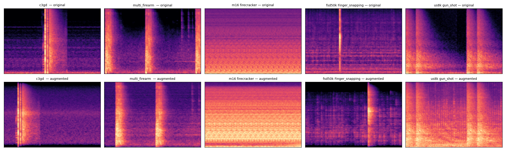
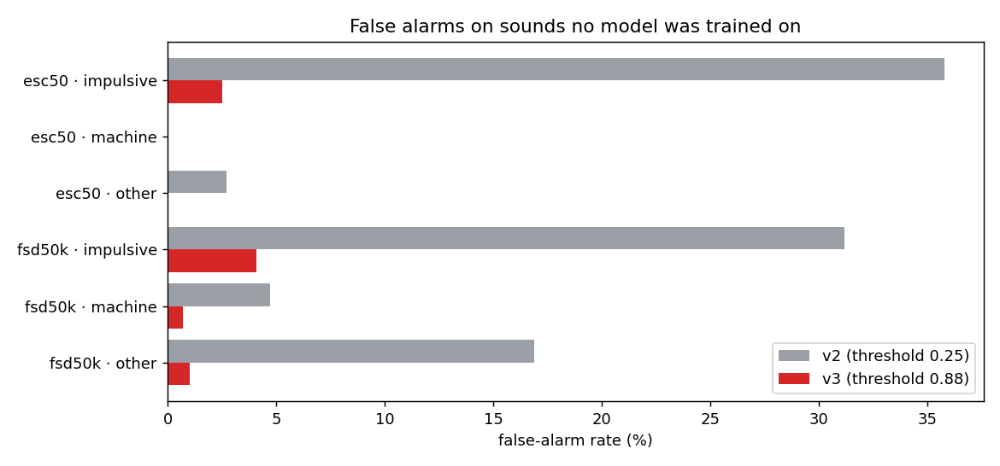
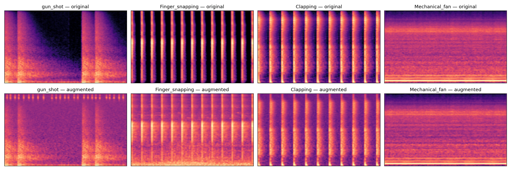

# ShotShield — Gunshot Detection in Everyday Audio

ShotShield is a convolutional neural network that listens to audio and flags gunshots. It turns sound into
mel spectrograms, scans them in 4-second windows, and reports **where** in a recording a gunshot was likely
fired. The current model (v4) learned from about 15,300 gunshots and 23,200 other sounds: real gunshots from
dozens of guns, distances and microphones (including phones), city noise, firecrackers, and the sharp everyday
sounds that are easy to mistake for a shot, such as finger snaps, claps, knocks, door slams and typing. Half of
its training copies were also passed through a simulated loudspeaker, room and laptop microphone.

**[▶ Try the live demo](https://nishttw.github.io/ShotShield/)**: it listens to your microphone and runs the
model in your browser. Your audio is never uploaded.



## Results

A gunshot detector has to do two things: catch gunshots, and stay quiet for everything else.

### v4: many more real gunshots, and the speaker/room/microphone chain

In a live test, v3 caught only 13 of 27 YouTube gunshots played through a laptop speaker. The recordings showed
three gaps: the speaker removes the bass, rapid fire and dry cracks were rare in the training data, and no
training clip had ever passed through a loudspeaker, a room and a laptop microphone. v4 keeps the network and the
input format and changes the **data**
([`notebooks/shotshield_v4_training.ipynb`](notebooks/shotshield_v4_training.ipynb)): five open gunshot datasets
(all CC BY 4.0), firecrackers as hard negatives, and a simulated playback chain (MP3 → small loudspeaker → room →
laptop microphone) for half of the augmented copies.

**Both models on the same test recordings**, which neither was trained on. Each new dataset is split so that a
whole recording event, session or direction is held out. v3 uses its threshold of 0.88; v4 ships with **0.80**
(see below).

| Test set | Gunshots caught: v3 | v4 | False alarms: v3 | v4 |
|---|---|---|---|---|
| UrbanSound8K fold 10 (32 gunshots, 805 other) | 27 (84%) | 27 (84%) | 2 | **1** |
| FSD50K eval: gunshots from very different recordings (119), other sounds (2,365) | **54 (45%)** | 45 (38%) | 57 | **47** |
| ESC-50 fold 5 (386 other sounds) | – | – | **1** | 5 |
| [C3GD](https://arxiv.org/abs/2606.18135), unseen recording event (1,990 shots, 48 guns, phones and studio mics) | 932 (47%) | **1,885 (95%)** | – | – |
| [Multi-firearm set](https://zenodo.org/records/7004819), unseen session (342 recordings, bursts, phones) | 52 (15%) | **317 (93%)** | – | – |
| [Belize](https://data.mendeley.com/datasets/x48cwz364j/3) forest, later period (150 shots, 600 background) | 67 (45%) | **127 (85%)** | 1 | 2 |
| [M16 + firecrackers](https://data.mendeley.com/datasets/kbgw323248), unseen directions (75 shots, 129 firecrackers) | 57 (76%) | **72 (96%)** | 6 | **1** |
| [SESA](https://zenodo.org/records/3519845) test (21 gunshots, 84 other) | 17 (81%) | **18 (86%)** | 7 | **1** |
| **All of the above** (2,729 gunshots, 4,369 other sounds) | 1,206 (44%) | **2,491 (91%)** | 74 (1.7%) | **57 (1.3%)** |
| Test clips re-made through the simulated speaker chain (1,500 + 1,496) | 376 (25%) | **1,179 (79%)** | **21** | 43 |
| **Real test: 27 YouTube gunshots through a laptop speaker and mic** | **13** | 10 | – | – |

- **v4 is far better on real gunshots from other guns, distances and microphones**, with fewer false alarms
  overall, and far fewer on explosions and firecrackers (explosions/booms 17 → 3 of 98, firecrackers 6 → 1 of 129).
- **It did not fix the problem it was built for.** On the 27 laptop recordings, v4 scores lower than v3 on 23
  of them. The simulated playback chain helps on simulated audio, but it doesn't yet match a real laptop speaker
  and microphone. (A caveat: these 27 clips were saved while v3 was running, which may favour v3.) The next data
  step is real recordings through the target microphone.
- **It does slightly worse on FSD50K's gunshots** (38% vs 45%), the most varied recordings in the test.
- **Threshold.** The notebook picked 0.64 (best F1 on validation), but the validation data is mostly C3GD
  gunshots, which pulls the threshold down: at 0.64 the demo's finger-snap example (73%) would fire. **0.80** gives
  fewer false alarms than v3 on the combined test sets and still catches 91%. It was chosen after looking at the
  test results, so these v4 numbers are slightly optimistic. Results at both thresholds, per-clip predictions and
  false alarms per class are in [`results/`](results) (`test_results_v3_vs_v4.csv`, `predictions_v4.csv`,
  `test_false_alarms_by_class_v4.csv`).
- **Game audio experiment.** A second model trained with in-game PUBG gun sounds (BGG, non-commercial research
  data, never shipped) caught more gunshots in UrbanSound8K and FSD50K but fewer in C3GD and Belize, and raised
  more false alarms ([`results/bgg_experiment_v4.csv`](results/bgg_experiment_v4.csv)).



### v3: hard negatives

v2 was trained on
UrbanSound8K only and did the first well. In a live test, though, a finger snap next to a laptop microphone
scored 97%: UrbanSound8K has no snaps, claps or knocks, so v2 had learned "sharp bang ⇒ gunshot". v3 adds those
sounds as negatives.

**Both models on the same test clips**, which neither was trained on. Each model uses its own threshold, tuned
on its validation data:

| Test set | v2 (threshold 0.25) | v3 (threshold 0.88) |
|---|---|---|
| UrbanSound8K test fold 10: 32 gunshots, 805 other sounds (precision / recall / F1) | 0.941 / 1.000 / 0.970 | 0.941 / 1.000 / 0.970 |
| **Other sounds** from ESC-50 fold 5 + FSD50K eval (2,729 clips): false alarms | 591 (21.7%) | **71 (2.6%)** |
| … of which sharp, impulsive sounds (1,617 clips) | 510 (31.5%) | **64 (4.0%)** |
| **Gunshots from other recordings** (FSD50K eval, 119 clips): caught | **81 (68.1%)** | 71 (59.7%) |

| Sound (unseen test clips) | v2 false alarms | v3 false alarms |
|---|---|---|
| Finger snapping | 24 / 30 | **1 / 30** |
| Knock | 17 / 28 | 0 / 28 |
| Typing and keyboards | 24 / 57 | 0 / 57 |
| Door slams and doors | 18 / 59 | 0 / 59 |
| Crack | 25 / 30 | 2 / 30 |
| Clapping | 11 / 29 | 2 / 29 |
| Fireworks, explosions, booms | 37 / 96 | 29 / 96 |
| Fans, microwaves, engines, motorcycles | 5 / 117 | 0 / 117 |



**10-fold cross-validation** on UrbanSound8K (mean ± std, threshold 0.5). The protocol is the same as for v2,
so the numbers are comparable: each fold is the test set once, and the extra datasets are only added to training
and validation.

| | Precision | Recall | F1 | ROC-AUC | PR-AUC | Hard negatives: false alarms | FSD50K gunshots caught |
|---|---|---|---|---|---|---|---|
| v2 | 0.892 ± 0.143 | 0.897 ± 0.128 | 0.880 ± 0.089 | 0.989 ± 0.033 | 0.966 ± 0.086 | – | – |
| v3 | 0.773 ± 0.258 | 0.969 ± 0.062 | 0.831 ± 0.185 | **0.998 ± 0.004** | **0.974 ± 0.045** | 10.5% ± 9.2% | 70.3% ± 10.6% |

- **v3 separates gunshots from other sounds better**: both ROC-AUC and PR-AUC are higher and far more stable
  between folds.
- **A threshold of 0.5 is too low for v3.** Learning from many more sounds pushed its scores up, so at 0.5 it
  flags too much. Precision and F1 drop, mostly because of two folds (1 and 8, precision 0.36 and 0.32). This is
  why the final model's threshold, tuned on validation data, is 0.88 rather than 0.5. Per-fold numbers are in
  [`results/cv_results_v3.csv`](results/cv_results_v3.csv).
- All numbers are for the **gunshot** class. Accuracy is left out on purpose: gunshots are a small minority, so a
  model that never says "gunshot" would already score above 95%.

### What v3 still got wrong

- **Fireworks, explosions and booms** were still flagged about a third of the time (29 of 96).
- **Gunshots unlike the training data** (other guns, distances and recorders in FSD50K) were caught only 60% of
  the time at the 0.88 threshold, a little less than v2's 68%. Per-class numbers are in
  [`results/hard_test_false_alarms_by_class.csv`](results/hard_test_false_alarms_by_class.csv).

Both led to v4. v4 still confuses fireworks (14 of 37 test clips), and sometimes glass, cracks and dropped coins.

### v2 error analysis (UrbanSound8K only)

Kept for reference; it motivated v3.

**False alarms by class** (cross-validation, threshold 0.5): of v2's 52 false alarms on UrbanSound8K, the largest
groups were air conditioners (19), drilling (8) and idling engines (8). Steady machine noise with sharp clicks or
onsets was the main weakness.

**Shortcut check:** most gunshot clips are short, so a model could learn "short clip ⇒ gunshot".

| Clip length | Non-gunshot clips | False-alarm rate | Gunshot recall |
|---|---|---|---|
| < 1 s | 364 | 1.6% | 0.88 |
| 1–2 s | 357 | 1.4% | 0.89 |
| 2–3 s | 203 | 1.0% | 0.89 |
| 3–4 s | 116 | 1.7% | 0.83 |
| 4 s (full) | 7,318 | 0.5% | **0.94** |

Gunshot recall doesn't drop for long clips, so the model isn't detecting gunshots by clip length. Short
*non*-gunshot clips trigger false alarms about 3× more often than full-length ones: a side effect of loop padding,
since repeating a short clip can create a train of sharp onsets that resembles gunfire.

v2's cross-validation and final-model charts: [`assets/cross_validation.png`](assets/cross_validation.png),
[`assets/final_model.png`](assets/final_model.png).

## How it works

```
audio file ──► resample to 22,050 Hz mono
           ──► split into 4 s windows (1 s hop)
           ──► log-mel spectrogram, 128 bands × 173 frames, scaled 0–1
           ──► CNN ──► P(gunshot) per window
           ──► windows above the threshold merged into time ranges
```

**Model:** three convolution blocks (32 → 64 → 128 filters, BatchNorm, ReLU, max pooling, dropout), then global
average and global max pooling, a 64-unit dense layer and a sigmoid output: 304,289 parameters. Global
max pooling fits the task: one loud, short event anywhere in the window should be enough to fire.

**Training:** Adam, binary cross-entropy, balanced class weights for the rare gunshot class, early stopping on
validation PR-AUC. The decision threshold is tuned on the validation data and then applied unchanged to the
test data.

## From v1 to v4

The first version of ShotShield ([`notebooks/v1_original.ipynb`](notebooks/v1_original.ipynb)) reported high
accuracy. A closer look showed it wasn't measuring what I thought it was:

| Problem in v1 | Why it mattered | Fix in v2 |
|---|---|---|
| Trained on **gunshot vs dog bark** only | Any other sound (a siren, a drill) was forced into one of those two answers | Gunshot vs **all** nine other classes |
| Short clips padded with **0 dB**, the *loudest* value after `power_to_db(ref=max)` | Most gunshot clips are short, so the model could learn "padding ⇒ gunshot" | Short clips are **looped** to fill 4 s, and a shortcut check in the notebook confirms clip length isn't being used |
| Random `train_test_split` | Slices of the same recording ended up in both train and test, inflating the score | The official 10 folds and 10-fold cross-validation |
| Accuracy as the only metric | Meaningless with 4% positives | Precision, recall, F1, ROC-AUC, PR-AUC, confusion matrix |
| `Flatten → Dense(64)`: 5.2M parameters, 99% in one layer | Large, overfits, tied to one input size | Global pooling: about 17× fewer parameters |
| Label order and preprocessing not saved | Inference code had to guess | `model_info.json` stores labels, threshold and feature settings |

v2 scored well on UrbanSound8K but failed in the live demo, so v3 changed the **data**, not the network
([`notebooks/shotshield_v3_training.ipynb`](notebooks/shotshield_v3_training.ipynb)):

| Problem in v2 | Fix in v3 |
|---|---|
| UrbanSound8K's only short, sharp sound is a gunshot, so snaps, claps and knocks looked like gunshots | Added ESC-50 (all 50 classes) and FSD50K hard negatives: snaps, claps, knocks, slams, dishes, typing, fireworks, fans, microwaves, engines, … (capped per class) |
| 374 gunshots, all from UrbanSound8K | + FSD50K's gunshot clips |
| Only tested on UrbanSound8K | Two extra test sets no model trains on: ESC-50 fold 5 + FSD50K eval (hard negatives), FSD50K eval gunshots (other recordings). v2 is scored on the same clips |
| Clean recordings only | One augmented copy of every training clip: room reverb, small-microphone EQ, background noise, soft clipping (a sound right next to the mic) |
| – | The three datasets all come from Freesound, so any clip whose Freesound ID appears in UrbanSound8K is removed from the others. Digital silence (ESC-50 pads short events with zeros) is trimmed, so "perfect silence" can't become a shortcut |



v3 failed the live test with gunshots played through a laptop, so v4 changed the data again
([`notebooks/shotshield_v4_training.ipynb`](notebooks/shotshield_v4_training.ipynb), code in
[`augment.py`](src/shotshield/augment.py), [`windows.py`](src/shotshield/windows.py) and
[`sources.py`](src/shotshield/sources.py)):

| Problem in v3 | Fix in v4 |
|---|---|
| 803 gunshots from two Freesound-based datasets | + C3GD (12,112 shots), multi-firearm (bursts, 27 microphones), Belize, M16, SESA: about 15,000 gunshots |
| Firecrackers missing | The M16 set's firecrackers as negatives, plus forest background (Belize) and explosions (SESA) |
| Never trained on audio played through a speaker | Half of the augmented copies go through MP3 → loudspeaker (bass cut at 80–500 Hz, resonance, limiter) → room → laptop mic; the bass loss was matched to the live-test recordings |
| Short clips were looped to 4 s: a 1 s gunshot became four identical shots exactly 1 s apart | Short sounds are placed once at a random position over a quiet background, for gunshots and other sounds alike |
| Long recordings: only the first 4 s | The loudest 4 s (or the k-th loudest event), and a random crop around it for augmented copies |
| Test sets from the same datasets as training | Unseen recording events, sessions and directions of the new datasets, simulated playback, and the live-test recordings |

## Quick start

```bash
git clone https://github.com/nishttw/ShotShield.git
cd ShotShield
pip install -r requirements.txt
```

Download `shotshield_v4.keras` and `model_info.json` from the
[Releases page](https://github.com/nishttw/ShotShield/releases) into `models/`. Then:

```bash
python predict.py path/to/recording.wav
```

```bash
python app.py
```

`predict.py` prints whether a gunshot was found and when. `app.py` starts a web demo at
http://127.0.0.1:7860 where you can upload or record audio.

## Browser demo

The [live demo](https://nishttw.github.io/ShotShield/) (in [`docs/`](docs), served by GitHub Pages) runs the
same model without a server:

```
microphone (raw: no noise suppression, no auto gain)
  ──► AudioWorklet ──► windowed-sinc resampler (48 / 44.1 kHz → 22,050 Hz)
  ──► rolling 4 s buffer, every 0.25 s:
  ──► log-mel spectrogram in JavaScript (docs/js/features.js)
  ──► ONNX model in ONNX Runtime Web (WebAssembly) ──► P(gunshot), threshold 0.80
```

On the page you can move the alarm line (threshold) to see the trade-off between missed gunshots and false
alarms, and save the last 8 s of microphone audio with a label ("gunshot" / "not a gunshot", or automatically at
every detection). Saved clips stay in the browser (IndexedDB) and download as a .zip of WAV files plus
`labels.csv`, ready to use as training data for the next model.

**It matches the Python pipeline numerically.** The JavaScript front-end is a port of
[`features.py`](src/shotshield/features.py): STFT with a periodic Hann window, `center=True` with zero padding,
librosa's own Slaney mel filterbank (exported as JSON), and `power_to_db(ref=max, top_db=80)`. Its output is
checked against librosa, and the full browser path is checked against the Keras model (v4):

| Check | Script | Largest difference |
|---|---|---|
| JS log-mel vs librosa 0.11 (noise, tones, clicks, loop padding, multi-window clips, silence, real clips) | `tools/verify_features.py` | ~1.9e-7 (float32 rounding, 0.00001 dB) |
| ONNX vs Keras on the same features (32 windows, on Kaggle) | `notebooks/shotshield_v4_training.ipynb` | 2.4e-7 |
| JS features → ONNX vs librosa → Keras, on synthetic signals and test clips | `tools/verify_onnx.py` | 6.0e-7, same decision on every window |
| The same, inside the browser (page → "Check this browser against Python") | `docs/js/app.js` | 1.3e-5 in Chromium (WebAssembly) |

The training notebook converts the model to ONNX and packages a web bundle (model, example clips, reference
data). To update the demo with a new bundle:

```bash
python tools/install_web_bundle.py shotshield_v4_web.zip --threshold 0.80
```

```bash
python tools/verify_features.py --reference tools/reference/reference.npz
```

```bash
python tools/verify_onnx.py
```

`--threshold` ships a different threshold from the notebook's (the original is kept in `model_info.json`). The
verification scripts need Node.js and `pip install onnxruntime`.

## Retraining

Open [`notebooks/shotshield_v4_training.ipynb`](notebooks/shotshield_v4_training.ipynb) on Kaggle, add the
UrbanSound8K dataset, enable a GPU and Internet, and use **Save & Run All (Commit)**. It downloads about 13 GB
(ESC-50, selected FSD50K clips, C3GD, multi-firearm, Belize, M16, SESA, and BGG for the optional experiment),
computes features with augmentation (about 25 minutes on 4 CPU cores), trains v4 (about 1 hour on a T4), scores
v3 on the same test sets, trains the BGG comparison model, and packages `shotshield_v4_outputs.zip` and
`shotshield_v4_web.zip`. The whole run took about 2.5 hours. The v2 and v3 notebooks are still there for
comparison.

## Repository layout

```
├── docs/                              browser demo (GitHub Pages): page, JS front-end, ONNX model, example clips
├── tools/                             export the mel filterbank, install the web bundle, verification scripts
├── notebooks/
│   ├── shotshield_v4_training.ipynb   v4: open gunshot datasets, playback augmentation, v3-vs-v4 evaluation (Kaggle)
│   ├── shotshield_v3_training.ipynb   v3: hard negatives, augmentation, v2-vs-v3 evaluation, ONNX export (Kaggle)
│   ├── shotshield_v2_training.ipynb   v2: UrbanSound8K only (Kaggle)
│   ├── shotshield_v2_export_web.ipynb v2 Keras → ONNX conversion + reference data (Kaggle)
│   └── v1_original.ipynb              first version, kept for comparison
├── src/shotshield/
│   ├── features.py                    audio → log-mel spectrogram (same settings as training)
│   ├── detector.py                    sliding-window inference and event merging
│   ├── augment.py                     augmentation: room, microphone, loudspeaker playback, MP3, backgrounds
│   ├── windows.py                     which 4 s of a long recording to use (loudest / k-th loudest event)
│   └── sources.py                     downloaders and splits for the open gunshot datasets
├── predict.py                         command-line tool
├── app.py                             Gradio web demo
├── assets/                            figures used in this README
├── results/                           per-fold and per-class results, data manifest, model settings (model_info.json)
└── models/                            put the downloaded model here (not stored in git)
```

## Limitations

- **Research project, not a safety system.** Don't rely on it to detect real gunfire.
- Fireworks are still mistaken for gunshots about a third of the time (14 of 37 test clips).
- Gunshots very unlike the training data are still hard: v4 catches 38% of FSD50K's test gunshots at 0.80.
- Gunshots played through a laptop speaker and picked up by its microphone are missed more often than not (10
  of 27 caught in a live test). The simulated playback chain doesn't capture a real speaker and room well enough
  yet; recordings made with the target microphone would help most.
- Most of v4's test gunshots come from the same datasets as its training gunshots (different events, sessions
  and directions), so its numbers on them are higher than they would be on truly new recordings.
- Clips are judged in 4-second windows; the model doesn't count individual shots.
- Results vary between folds and between training runs. Averaging several models trained with different seeds
  would make it more stable.

## Ideas for future work

- Record local fireworks, firecrackers, household sounds and speaker-played gunshots with the target microphone.
- Compare with a pretrained audio model (YAMNet, PANNs, BEATs) plus a small gunshot classifier.
- Measure false alarms per hour on long recordings of ordinary background sound.
- A small int8 model for a microcontroller (ESP32) with a microphone.

## Datasets and credits

- **UrbanSound8K** by J. Salamon, C. Jacoby and J. P. Bello, CC BY-NC 3.0
  ([official site](https://urbansounddataset.weebly.com/urbansound8k.html)).
  J. Salamon, C. Jacoby and J. P. Bello, "A Dataset and Taxonomy for Urban Sound Research", ACM Multimedia 2014.
- **ESC-50** by K. J. Piczak, CC BY-NC 3.0 ([GitHub](https://github.com/karolpiczak/ESC-50)).
  K. J. Piczak, "ESC: Dataset for Environmental Sound Classification", ACM Multimedia 2015.
- **FSD50K** by E. Fonseca, X. Favory, J. Pons, F. Font and X. Serra; dataset CC BY 4.0, clips under their own
  Creative Commons licenses ([Zenodo](https://zenodo.org/records/4060432)). "FSD50K: An Open Dataset of
  Human-Labeled Sound Events", IEEE/ACM TASLP 2022. Clips were downloaded from the Hugging Face mirror
  `Fhrozen/FSD50k`.
- **C3GD** by S. Gurny and R. Quinn (Certus Innovations), CC BY 4.0 ([arXiv:2606.18135](https://arxiv.org/abs/2606.18135)).
- **Multi-firearm, multi-orientation gunshot dataset** by R. Kabealo et al., CC BY 4.0
  ([Zenodo](https://zenodo.org/records/7004819), doi:10.1016/j.dib.2023.109091).
- **Tropical forest gunshot dataset (Belize)** by L. Katsis et al., CC BY 4.0
  ([Mendeley Data](https://data.mendeley.com/datasets/x48cwz364j/3)).
- **M16 rifle gunshots and firecrackers**, CC BY 4.0 ([Mendeley Data](https://data.mendeley.com/datasets/kbgw323248)).
- **SESA** (Sound Events for Surveillance Applications), CC BY 4.0 ([Zenodo](https://zenodo.org/records/3519845)).
- **BGG** in-game PUBG gun sounds by J. Park et al., non-commercial research only: used in one comparison
  experiment, never in a shipped model.

No audio datasets are included in this repository, except the demo's example clips, which are credited on the
page. The lists of clips used are in [`results/data_manifest_v3.csv`](results/data_manifest_v3.csv) and
[`results/data_manifest_v4.csv`](results/data_manifest_v4.csv).

## License

Code: [MIT](LICENSE). The trained models were learned from datasets with non-commercial terms (UrbanSound8K,
ESC-50, some FSD50K clips), so use them for non-commercial purposes only.
